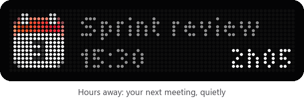
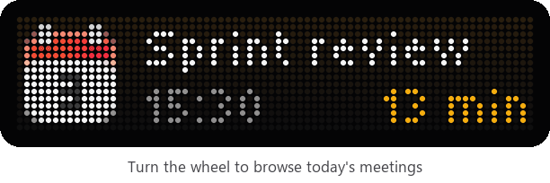
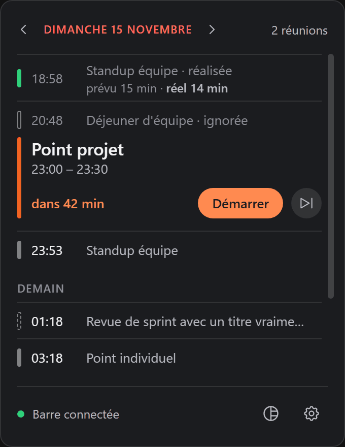

# Meeting Display

**Your next meeting, always in sight, on your [BUSY Bar](https://busy.app).**

Meeting Display is a small Windows tray app. It reads your calendar and turns the BUSY Bar on
your desk into a meeting companion: what is next, when to leave, how long is left, and how
late you are running.

No account, no cloud, no browser extension. One calendar link, one USB cable.

## What you get

- **A glance is enough.** The bar shows the next meeting and how far away it is. It warms up
  15 minutes before, counts down the last 5, and tells you when it is time.
- **Time left, not time of day.** Press Start when the meeting begins: the bar counts down to
  the end, then shows how far over you are.
- **Hands on the bar, not on the mouse.** Turn the wheel to step through your meetings, today
  and the days after, press Start to begin one early, Back to skip it.
- **A soft sound, never a beep.** A gentle note as a meeting approaches, a chime when its
  time is up. Quiet hours and a discreet mode silence everything.
- **Your day, kept.** The panel keeps 30 days of history: what you attended, what you skipped,
  planned time against real time.
- **Private by design.** Your calendar is read on your PC and nothing leaves it. The app talks
  to the bar over its local connection only.
- **Updates itself.** Install once.

## On the bar

| On the bar | What it does |
|---|---|
| Wheel | one notch, one meeting: the next or the previous one, across days |
| Start | begin the selected meeting, end the one in progress, or bring back one you skipped |
| Back | skip the selected meeting |
| OK | return to the current meeting |

The wheel and buttons need the small companion app that runs on the bar itself: see
[`bar-app/README.md`](bar-app/README.md). Without it, the display works the same and you drive
everything from the panel.

## On your PC

Click the tray icon to open the panel: today's agenda, one button for the obvious next
action, and the arrows to look back over the last 30 days. Light and dark themes.
The panel is in French for now.

## Get started

1. **Plug in your BUSY Bar** over USB.
2. **Install Meeting Display**: download the latest `setup.exe` from the
   [Releases](../../releases/latest) page and run it.
3. **Publish your calendar as an ICS link.** In Outlook on the web: Settings → Calendar →
   Shared calendars → Publish a calendar → copy the **ICS** link. Any other calendar that
   offers an ICS link works too.
4. **Paste the link** in the panel's settings (the gear icon). Treat it like a password: anyone
   who has it can read your calendar. It is stored on your PC only.

That is all. Your next meeting appears on the bar within a few seconds.

## Good to know

- Windows only for now.
- The calendar is read-only: Meeting Display never changes your meetings.
- Only what an ICS link carries is available: titles and times, not attendees.
- This is a personal project, not affiliated with Flipper Devices, the makers of BUSY Bar.

## Going further

- **Full user guide, build and release** (in French): [`app/README.md`](app/README.md)
- **The on-bar companion app**: [`bar-app/README.md`](bar-app/README.md)
- **What is tested and what is not**: [`docs/STATUS.md`](docs/STATUS.md)

## Credits

The calendar icon shown on the bar (`app/src-tauri/assets/calendar.png`) comes from the
official [Clock app](https://github.com/busy-app/clock-app) by Flipper Devices, MIT licence.

The animations above are built from real captures of the bar's screen.
